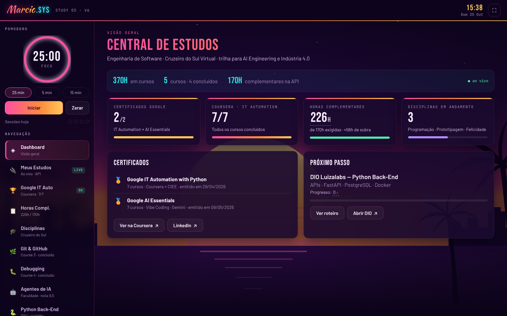
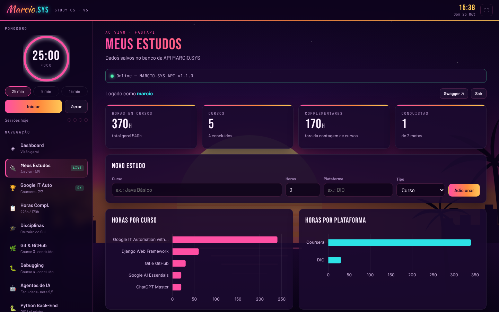

# MARCIO.SYS — Study OS

Painel pessoal de estudos com **API FastAPI**, autenticação **JWT** e banco **SQLAlchemy**. O painel acompanha minha trilha em Engenharia de Software (horas, cursos, metas e certificados) e é servido pela própria API.



| Meus Estudos (dados ao vivo) | Celular |
|---|---|
|  |  |

## O que ele faz

- **Login com JWT**: cada usuário vê só os próprios dados.
- **Estudos (CRUD completo)**: cadastrar, editar, somar horas, excluir. Tipos `curso`, `complementar`, `faculdade` e `livro`; as horas complementares da faculdade não inflam a contagem de cursos.
- **Metas e conquistas**: progresso de 0 a 100%; ao chegar em 100% a meta vira conquista com data.
- **Gráficos** de horas por curso e por plataforma (Chart.js).
- **Pomodoro**, checkpoints por módulo de estudo e conteúdo das disciplinas.
- Funciona no celular.

## Stack

| Camada | Tecnologia |
|---|---|
| API | FastAPI · Uvicorn · Pydantic v2 |
| Banco | SQLAlchemy (SQLite local, PostgreSQL em produção) |
| Autenticação | JWT (python-jose) · bcrypt |
| Front-end | HTML, CSS e JavaScript (ES modules, sem framework) · Chart.js |
| Testes | pytest · GitHub Actions |
| Deploy | Railway |

## Segurança

- Todo dado vindo da API é escapado antes de ir para a tela (proteção contra XSS).
- **Content-Security-Policy** só permite scripts, fontes e estilos do próprio servidor.
- Validação no back-end: curso vazio, horas negativas, mais de 24h por sessão, progresso fora de 0–100 e tipos inválidos são recusados.
- A API não sobe em produção com a `SECRET_KEY` padrão.
- Sessão expirada (401) leva de volta ao login.
- O cadastro de novos usuários pode ser desligado (`ALLOW_REGISTER=false`).

## Rodar local

```bash
python3 -m venv .venv
source .venv/bin/activate
pip install -r requirements-dev.txt
uvicorn app.main:app --reload
```

Abra **http://127.0.0.1:8000** (painel) ou **http://127.0.0.1:8000/docs** (Swagger).

Testes:

```bash
pytest -q
```

## Estrutura

```
app/
├── main.py            # app, CORS, cabeçalhos de segurança, serve o front-end
├── config.py          # variáveis de ambiente
├── database.py        # conexão com o banco
├── models.py          # tabelas User, Estudo, Meta
├── schemas.py         # validação Pydantic
├── security.py        # hash de senha + JWT
└── routers/           # auth, estudos, metas, github
frontend/
├── index.html
└── assets/
    ├── css/app.css    # tema "Sunset Drive"
    ├── js/            # main, api, dom (escape), store, timer, content, views/
    ├── fonts/         # fontes hospedadas no projeto (SIL OFL)
    └── vendor/        # Chart.js 4.4.1
tests/test_api.py      # 12 testes
```

## Endpoints

| Método | Rota | O que faz |
|---|---|---|
| GET | `/health` | Status da API |
| POST | `/auth/register` | Cria usuário |
| POST | `/auth/login` | Retorna token JWT |
| GET | `/auth/me` | Usuário logado |
| GET / POST | `/estudos` | Lista / cria estudos |
| PATCH / DELETE | `/estudos/{id}` | Edita / exclui |
| PATCH | `/estudos/{id}/horas?horas=1` | Soma horas (até 24 por vez) |
| GET | `/estudos/resumo` | Totais por curso, plataforma e tipo |
| GET / POST | `/metas` | Lista / cria metas |
| PATCH / DELETE | `/metas/{id}` | Atualiza progresso, conclui, reabre / exclui |
| GET | `/metas/conquistas` | Metas concluídas |
| GET | `/github/perfil` · `/github/repos` | Dados públicos do GitHub |

## Deploy no Railway

1. **New Project → Deploy from GitHub repo** com este repositório.
2. Adicione um **PostgreSQL** (New → Database). O Railway preenche `DATABASE_URL` sozinho.
3. Em **Variables**:
   - `SECRET_KEY`: gere com `openssl rand -hex 32` (obrigatório)
   - `ALLOW_REGISTER`: `false`, depois de criar sua conta
   - `GITHUB_TOKEN`: opcional, evita limite de requisições
4. O painel fica na URL do Railway, junto com a API.

Para hospedar o painel em outro lugar (Netlify, GitHub Pages), preencha `<meta name="api-base">` no `frontend/index.html` com a URL da API e inclua o domínio em `FRONTEND_ORIGINS`.

## Próximos passos

- Migrations com Alembic no lugar de `create_all`
- Dockerfile + docker-compose com PostgreSQL
- Levar disciplinas e horas complementares para a API
- Refresh token
